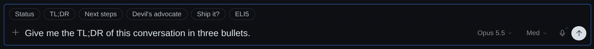

# Quick prompts

A Hermes Desktop plugin that puts your recurring prompts one click away. Each prompt is a small button above the chat input. Click it and the prompt fills the input, ready to edit; it never sends on its own.



It ships with three prompts (Status, Summarize, Next steps). Change them under **Settings → Plugins → Quick prompts**: add, edit, reorder or remove prompts, or reset to the defaults. Edits apply as you type.


## Install

```bash
hermes plugins install quick-prompts
```

Then switch it on under **Capabilities → Plugins**.

Requires Hermes 0.21.6 or later, which added the composer draft API the plugin uses.

## What it does and doesn't do

- Writes only to the chat input of the session you're in, through the plugin SDK's `host.composer` API.
- Stores your prompts in the app's local storage, so each browser or desktop install keeps its own list.
- Makes no network calls, registers no agent tools or hooks, and needs no API keys.
- Keeps up to 24 prompts.

## License

MIT
